<p align="center">
  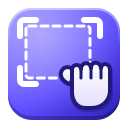
</p>

<h1 align="center">GrabbyHands</h1>

<p align="center"><b>Grab, mark up and copy screenshots on GNOME.</b><br>
Press <kbd>Print Screen</kbd>, drag over what you want, and copy, save, edit or pin it in one click.</p>

> [!IMPORTANT]
> **This is a v0.x release: GrabbyHands' first public version.** I believe it's stable on
> Ubuntu 24.04 and newer and on Debian 13, but bugs may exist. Other distros with GNOME 46 or
> newer should work through the Flatpak; they have had less testing. If you find a bug, please
> [report it](https://github.com/al3phnul/GrabbyHands/issues/new/choose)!

<p align="center">
  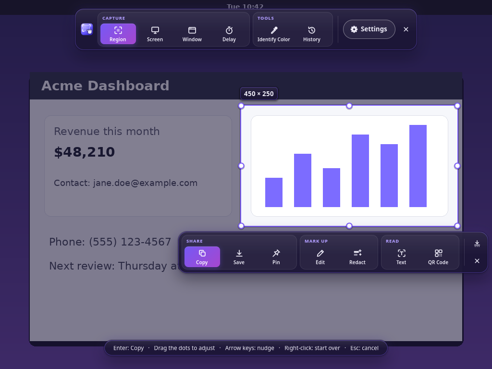
</p>

GrabbyHands is a screenshot tool for the GNOME desktop on Wayland, in the spirit of the power
tools people love on Windows. It is free software and runs entirely on your computer:
**no network access, no uploads, no accounts**.

**Contents:** [What it does](#what-it-does) · [Install](#install) · [First run](#first-run) ·
[Keyboard](#keyboard) · [Settings](#settings) · [Troubleshooting](#troubleshooting) ·
[Uninstall](#uninstall) · [Privacy](#privacy) · [Contributing](#contributing) · [License](#license)

## What it does

### Capture what you need

Press <kbd>Print Screen</kbd> and the screen freezes. Drag over an area, press <kbd>Space</kbd>
for the whole screen, or press <kbd>W</kbd> and click a window. A magnifier shows the exact
pixel under the pointer. Then pick an action: **Copy**, **Save**, **Pin**, **Edit**, **Redact**,
**Text** or **QR Code**.

There is also a delay timer (for menus and tooltips) and a shortcut that captures the same
area again.

<p align="center">
  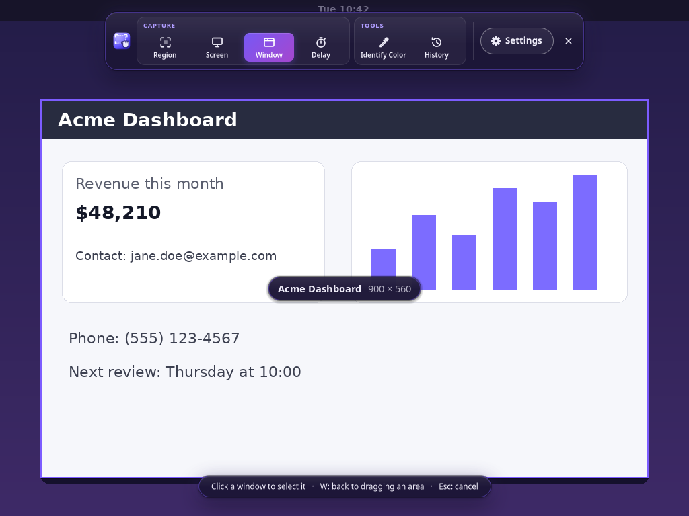
</p>

### Mark it up

**Edit** opens the editor: arrows, lines, boxes, circles, pen, highlighter, text, callouts,
numbered steps, stickers, crop, spotlight and magnify. Everything you draw stays editable, the
eraser only removes your drawing (never the screenshot), and you can reopen any capture later.

<p align="center">
  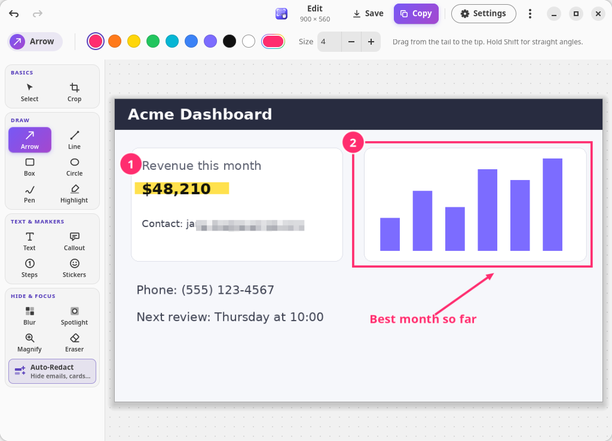
</p>

### Hide personal details

Blur, pixelate or black out anything by hand. Or click **Auto-Redact**: GrabbyHands finds
emails, phone numbers, card numbers, ID numbers, IP addresses and API keys in the picture and
covers them in one step. You check the result before you share it.

<p align="center">
  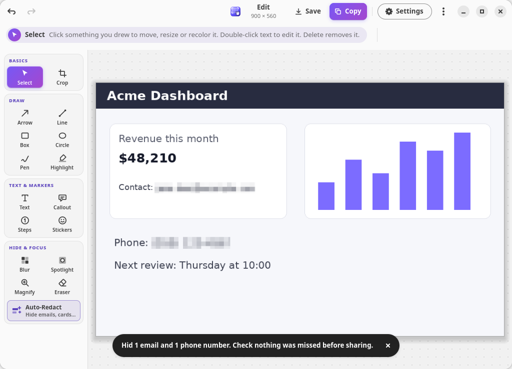
</p>

### Copy text and read QR codes

**Text** recognizes the words in a screenshot (on your computer, with Tesseract). Drag across
the words you want, or copy everything. **QR Code** reads QR codes and barcodes.

<p align="center">
  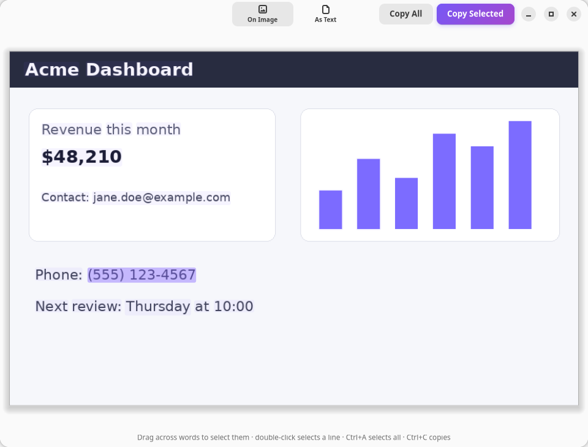
</p>

### Identify Color

Hover any pixel to see its HEX, RGB and CMYK values. Click it for a window with a copy button
for each value.

<p align="center">
  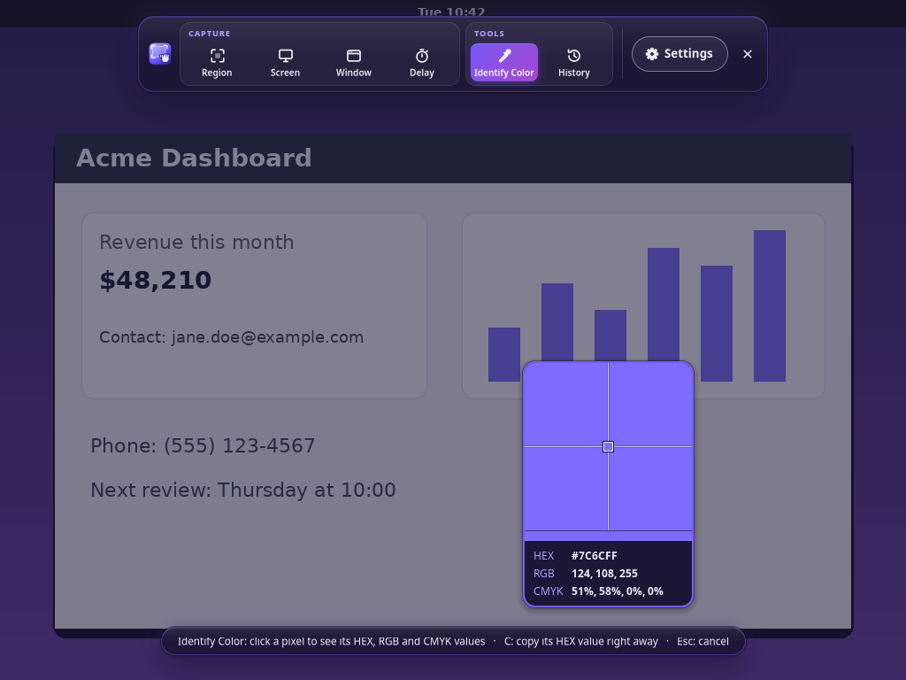
  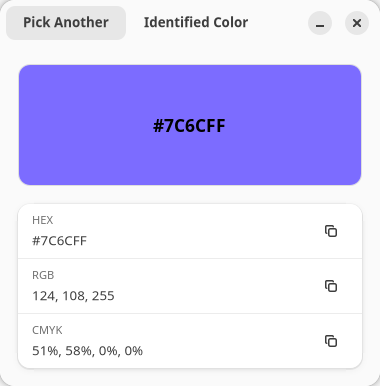
</p>

### History and pins

Every capture is kept in a history you can browse, re-edit, delete (with Undo) or clear.
**Pin** keeps a screenshot floating on top of your other windows as a reference.

<p align="center">
  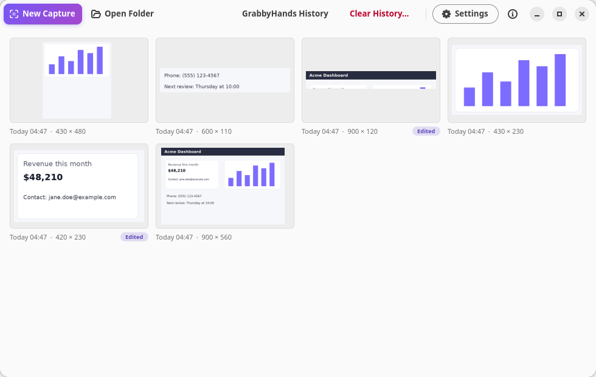
</p>

### Your colors

Violet by default, with Ocean, Mint, Sunset, Rose, Amber, Graphite or your GNOME accent color,
in light or dark style.

<p align="center">
  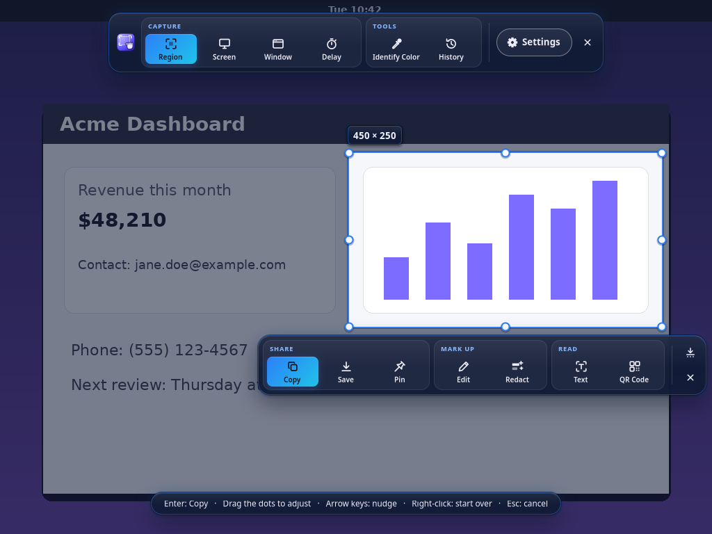
  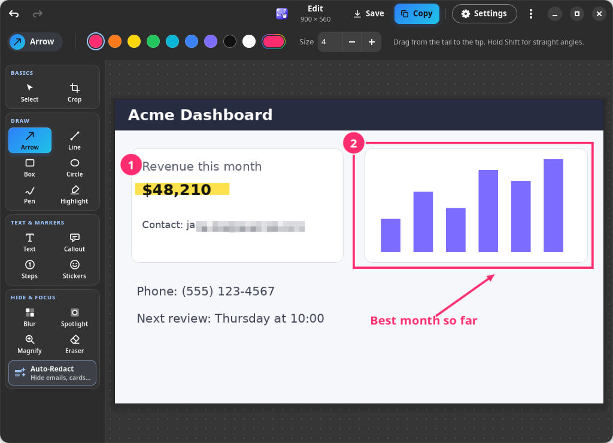
</p>

## Install

**What you need:** the GNOME desktop, version 46 or newer, in a Wayland session. That covers
Ubuntu 24.04 and newer, Debian 13 and Fedora 40 and newer. On GNOME 48 and newer GrabbyHands
sets up its keyboard shortcuts through GNOME; on GNOME 46 and 47 you add one shortcut by hand
(see [First run](#first-run)).

Download the files from the
[latest release](https://github.com/al3phnul/GrabbyHands/releases/latest) and pick one method:

| Method | Good for | What gets installed |
|---|---|---|
| [Flatpak](#flatpak-any-distro) | Any distro | GrabbyHands with everything it needs inside (about 18 MB), plus the GNOME 50 runtime from Flathub if you don't have it yet |
| [.deb package](#debian-and-ubuntu-deb) | Ubuntu 24.04+, Debian 13+ | GrabbyHands (under 1 MB) and, through apt, the system packages it uses |
| [From source](#from-source) | Developers, other distros | Whatever you build, into the folder you choose |

### Flatpak (any distro)

You need [Flatpak](https://flatpak.org/setup/) itself (Fedora has it out of the box; on Ubuntu
run `sudo apt install flatpak`).

1. Download `GrabbyHands-<version>-x86_64.flatpak`.
2. In the folder you saved it to, run:

   ```sh
   flatpak install --user GrabbyHands-*.flatpak
   ```

3. Open **GrabbyHands** from your apps, or run `flatpak run io.github.al3phnul.GrabbyHands`.

What comes along:

- **Inside the app:** Pillow (images), Tesseract with English language data (text
  recognition), Leptonica and zxing-cpp (QR codes). Nothing else is downloaded for these.
- **From Flathub, once:** the GNOME 50 runtime (about 420 MB to download, shared with every
  other GNOME 50 Flatpak app). Flatpak offers to add Flathub for this if it isn't set up.
- **Permissions:** showing windows, the graphics card, the folder `Pictures/GrabbyHands`, and
  talking to the Window Helper. No network, no access to your other files.

The Flatpak can't add anything to GNOME Shell, so window capture needs one more file. Download
`grabbyhands@al3phnul.github.io.shell-extension.zip` from the same release and run:

```sh
gnome-extensions install grabbyhands@al3phnul.github.io.shell-extension.zip
```

Then follow [Turn on the Window Helper](#4-turn-on-the-window-helper-for-window-capture).

To update, download the new `.flatpak` file and run the install command again.

### Debian and Ubuntu (.deb)

1. Download `grabbyhands_<version>_all.deb`.
2. In the folder you saved it to, run:

   ```sh
   sudo apt install ./grabbyhands_*_all.deb
   ```

3. Open **GrabbyHands** from your apps.

Use `apt` as shown (not `dpkg -i`): apt fetches the other packages GrabbyHands needs from your
distro's own archive.

- **Always installed:** `python3-gi`, `python3-gi-cairo`, `python3-cairo`, `python3-pil`,
  `gir1.2-gtk-4.0`, `gir1.2-adw-1`, `gir1.2-pango-1.0` and `xdg-desktop-portal`. A GNOME desktop
  already has nearly all of them.
- **Recommended, installed by default:** `tesseract-ocr` (text recognition, with English) and
  `python3-zxing-cpp` (QR codes and barcodes). Without them GrabbyHands still works; the Text,
  Redact and QR Code buttons are simply hidden.
- **Included in the package:** the Window Helper extension. It stays off until you
  [turn it on](#4-turn-on-the-window-helper-for-window-capture).

To update, download the new `.deb` and run the install command again.

### From source

```sh
sudo apt install git meson gettext desktop-file-utils gtk-update-icon-cache libglib2.0-bin \
    python3-gi python3-gi-cairo python3-cairo gir1.2-gtk-4.0 gir1.2-adw-1 python3-pil \
    tesseract-ocr python3-zxing-cpp
git clone https://github.com/al3phnul/GrabbyHands.git
cd GrabbyHands
meson setup build --prefix="$HOME/.local"
meson install -C build
```

This installs into your home folder (no `sudo` for the last step): the `grabbyhands` command in
`~/.local/bin`, the app in `~/.local/share/grabbyhands`, its launcher, icons and settings
schema, and the Window Helper extension. If `grabbyhands` isn't found afterward, log out and
back in so `~/.local/bin` is on your PATH. On other distros install the same things under your
distro's names: Meson, gettext, PyGObject with GTK 4.14+ and libadwaita 1.5+, pycairo, Pillow,
and optionally Tesseract and the zxing-cpp Python module.

### Check your download (optional)

Every release has a `SHA256SUMS` file. Download it into the same folder and run:

```sh
sha256sum -c SHA256SUMS --ignore-missing
```

Each file should say `OK`. Releases are also signed with GitHub build provenance; if you use
the GitHub CLI: `gh attestation verify <file> --repo al3phnul/GrabbyHands`.

## First run

Four small things, once. After that Print Screen just works. The first time you open
GrabbyHands, its **Getting Started** window walks you through them (you can reopen it from the
Help menu in the History window). Here they are in full.

<p align="center">
  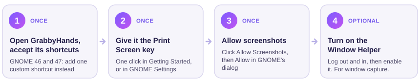
</p>

### 1. Open GrabbyHands and accept its shortcuts

Open **GrabbyHands** from your apps. From then on it keeps running quietly in the background
and starts again when you log in (you can turn that off in Settings).

- **GNOME 48 and newer** (Ubuntu 25.04+, Debian 13, Fedora 42+): GNOME shows a dialog listing
  GrabbyHands' shortcuts. Confirm it. If you dismissed it, use **Set Up Shortcuts** in Getting
  Started, or **Settings → General → Shortcuts that work anywhere**. You can change the keys
  later in GNOME **Settings → Apps → GrabbyHands**.
- **GNOME 46 and 47** (Ubuntu 24.04, Fedora 40 and 41): these versions can't hand shortcuts to
  apps yet, so add one yourself. In GNOME **Settings → Keyboard → View and Customize Shortcuts
  → Custom Shortcuts**, add a shortcut named `GrabbyHands` with the command
  `grabbyhands --capture` and press <kbd>Print Screen</kbd> as its key. With the Flatpak the
  command is `flatpak run io.github.al3phnul.GrabbyHands --capture`.

### 2. Give it the Print Screen key

GNOME's own screenshot tool uses <kbd>Print Screen</kbd>, and a key can only belong to one of
them. Pick whichever is easiest:

- **In GrabbyHands:** in Getting Started, click **Use Print Screen for GrabbyHands**. It moves
  GNOME's tool to <kbd>Ctrl</kbd>+<kbd>Print Screen</kbd>, and Undo is right there. (The
  Flatpak isn't allowed to change GNOME's settings, so it shows you the command below instead.)
- **In GNOME Settings:** open **Keyboard → View and Customize Shortcuts → Screenshots**, click
  **Take a screenshot interactively**, and press <kbd>Backspace</kbd> to turn it off (or give
  it another key).
- **With a command** that moves GNOME's tool to <kbd>Ctrl</kbd>+<kbd>Print Screen</kbd>:

  ```sh
  gsettings set org.gnome.shell.keybindings show-screenshot-ui "['<Ctrl>Print']"
  ```

If Print Screen doesn't respond afterward, log out and back in once.

<p align="center">
  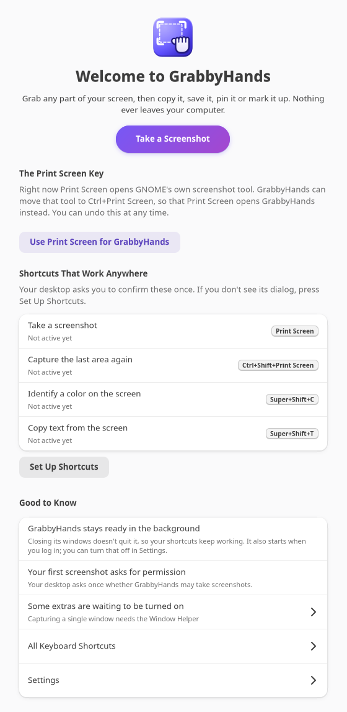
</p>

### 3. Allow screenshots

The first time you capture, GrabbyHands shows this window. Click **Allow Screenshots**, then
choose **Allow** in GNOME's dialog. GNOME remembers your answer.

<p align="center">
  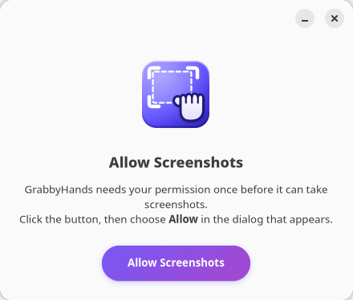
</p>

### 4. Turn on the Window Helper (for window capture)

Wayland doesn't tell apps where windows are, so capturing a single window uses a tiny GNOME
Shell extension, **GrabbyHands Window Helper**. It tells GrabbyHands the position and app name
of each visible window and nothing else: no window titles, no contents. Everything else works
without it; the Window button is just hidden.

1. **Log out and back in** once after installing, so GNOME notices the extension.
2. Turn it on with this command:

   ```sh
   gnome-extensions enable grabbyhands@al3phnul.github.io
   ```

   or flip its switch in the **Extensions** app (on Ubuntu:
   `sudo apt install gnome-shell-extension-prefs`) or in **Extension Manager**.

GrabbyHands **Settings → General → Window Capture** shows whether the helper is on.

### Optional: the screenshot button in the system menu

GNOME's system menu (top right of the screen) has a camera button that opens GNOME's own
screenshot tool. If you'd like that button to start GrabbyHands instead, turn on
**Settings → General → Use the system menu's screenshot button**. It needs the Window Helper,
because only an extension may change that menu. Turn the switch off and GNOME's button is back
at once; GNOME's own tool stays on its keyboard shortcut either way.

## Keyboard

**Anywhere** (the default keys; yours may differ if you changed them):

| Key | Does |
|---|---|
| <kbd>Print Screen</kbd> | Take a screenshot |
| <kbd>Ctrl</kbd>+<kbd>Shift</kbd>+<kbd>Print Screen</kbd> | Capture the last area again |
| <kbd>Super</kbd>+<kbd>Shift</kbd>+<kbd>C</kbd> | Identify Color |
| <kbd>Super</kbd>+<kbd>Shift</kbd>+<kbd>T</kbd> | Copy text from the screen |

**While capturing:**

| Key | Does |
|---|---|
| Drag | Select an area (drag the handles to adjust it) |
| <kbd>Space</kbd> | Whole screen |
| <kbd>W</kbd> | Window mode: click a window to select it |
| <kbd>R</kbd> | The last area again |
| <kbd>D</kbd> | Capture after a delay |
| <kbd>I</kbd> | Identify Color |
| <kbd>C</kbd> | Copy the color under the pointer (before you select an area) |
| <kbd>H</kbd> | Open History |
| Arrow keys | Move the selection by 1 px (<kbd>Shift</kbd>: 10 px, <kbd>Alt</kbd>: resize) |
| <kbd>Enter</kbd> | The default action (Copy, unless you changed it in Settings) |
| <kbd>Ctrl</kbd>+<kbd>C</kbd> · <kbd>S</kbd> · <kbd>P</kbd> | Copy · Save · Pin |
| <kbd>E</kbd> · <kbd>X</kbd> | Edit · Redact |
| <kbd>T</kbd> · <kbd>Q</kbd> | Text · QR Code |
| <kbd>Ctrl</kbd>+<kbd>S</kbd> | Save As |
| <kbd>Esc</kbd> | Cancel |

**In the editor:**

| Key | Does |
|---|---|
| <kbd>V</kbd> · <kbd>C</kbd> | Select · Crop |
| <kbd>A</kbd> · <kbd>L</kbd> · <kbd>R</kbd> · <kbd>O</kbd> · <kbd>P</kbd> · <kbd>H</kbd> | Arrow · Line · Box · Circle · Pen · Highlight |
| <kbd>T</kbd> · <kbd>K</kbd> · <kbd>N</kbd> · <kbd>G</kbd> | Text · Callout · Steps · Stickers |
| <kbd>B</kbd> · <kbd>S</kbd> · <kbd>M</kbd> · <kbd>E</kbd> | Blur · Spotlight · Magnify · Eraser |
| <kbd>Ctrl</kbd>+<kbd>Shift</kbd>+<kbd>R</kbd> | Auto-Redact |
| <kbd>Ctrl</kbd>+<kbd>Z</kbd> · <kbd>Ctrl</kbd>+<kbd>Shift</kbd>+<kbd>Z</kbd> | Undo · Redo |
| <kbd>Delete</kbd> | Remove the selected item |
| <kbd>Ctrl</kbd>+<kbd>C</kbd> · <kbd>Ctrl</kbd>+<kbd>S</kbd> · <kbd>Ctrl</kbd>+<kbd>Shift</kbd>+<kbd>S</kbd> | Copy · Save · Save As |
| <kbd>Ctrl</kbd>+<kbd>0</kbd> · <kbd>Ctrl</kbd>+<kbd>1</kbd> · <kbd>Ctrl</kbd>+<kbd>+</kbd> · <kbd>Ctrl</kbd>+<kbd>-</kbd> | Fit · Actual size · Zoom in · Zoom out |

Every button also shows its key in its tooltip, and the Help menu in the History window has
the full list.

**From a terminal or a custom shortcut:** `grabbyhands --capture`, `--window`, `--repeat`,
`--pick-color`, `--ocr`, `--delay N`, `--history`, `--preferences` and `--quit`
(`grabbyhands --help` lists them all).

## Settings

Open **Settings** from the capture toolbar, the History window or the editor.

<p align="center">
  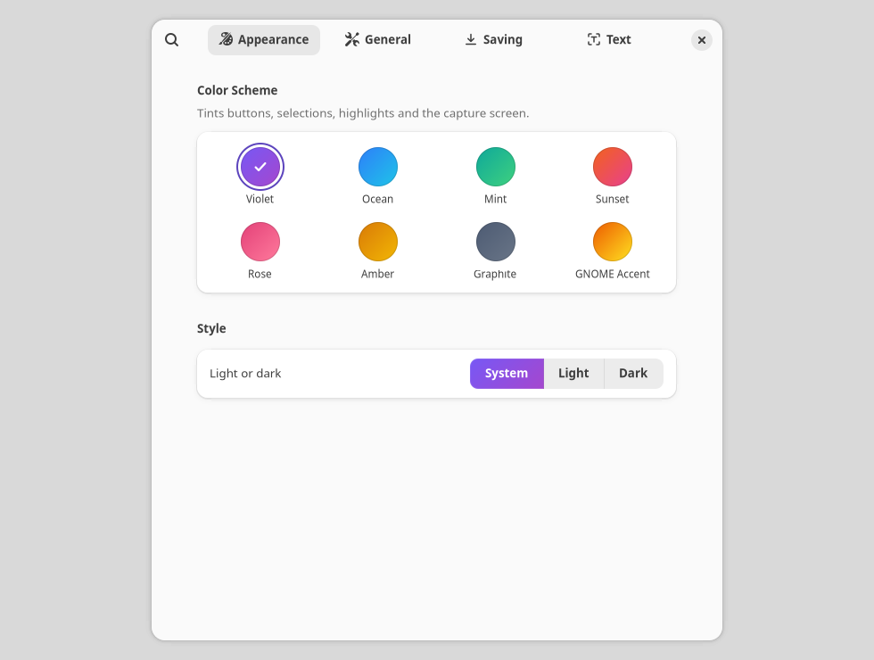
  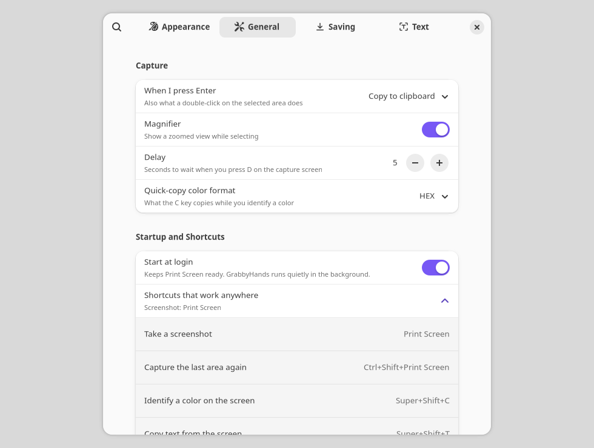
</p>

| Page | What you can change |
|---|---|
| **Appearance** | Color scheme; light, dark or follow the system |
| **General** | What <kbd>Enter</kbd> does, the magnifier, the delay, the color format, start at login, the shortcuts that work anywhere, the system menu's screenshot button, Window Helper status |
| **Saving** | Save every capture or not, the folder, the file name pattern, PNG / JPEG / WebP and quality, how many captures History keeps |
| **Text** | The language used for text recognition |

## Troubleshooting

**Print Screen still opens GNOME's screenshot tool.** GNOME's tool still owns the key: see
[step 2](#2-give-it-the-print-screen-key).

**Print Screen does nothing.** GrabbyHands may not be running: open it from your apps once and
keep **Start at login** on. Then check the shortcuts from
[step 1](#1-open-grabbyhands-and-accept-its-shortcuts): on GNOME 48 and newer they must be
confirmed, on GNOME 46 and 47 you add one by hand.

**It keeps asking for permission, or says it couldn't take a screenshot.** Open GNOME
**Settings → Apps → GrabbyHands** and turn on **Screenshots**.

**There is no Window button.** The Window Helper is off. See
[step 4](#4-turn-on-the-window-helper-for-window-capture); remember to log out and back in once.

**There are no Text, Redact or QR Code buttons.** Those need Tesseract and zxing-cpp. With the
.deb or a source install run `sudo apt install tesseract-ocr python3-zxing-cpp`, then quit
(`grabbyhands --quit`) and start GrabbyHands again. The Flatpak always has both.

**Text recognition in another language.** With the .deb or a source install, add the language
pack, for example `sudo apt install tesseract-ocr-deu` for German, then choose it in
**Settings → Text**. The Flatpak includes English only for now.

**Where are my screenshots?** In `Pictures/GrabbyHands` (change it in **Settings → Saving**).
The history, with the untouched originals, lives in `~/.local/share/grabbyhands`
(Flatpak: `~/.var/app/io.github.al3phnul.GrabbyHands/data/grabbyhands`).

**Does it work on X11, KDE or other desktops?** It is built and tested for GNOME on Wayland.
Other desktops that offer the Screenshot portal may work, without window capture.

**Reporting a bug.** Quit GrabbyHands, start it from a terminal with logging on, repeat the
problem, and attach the output to an
[issue](https://github.com/al3phnul/GrabbyHands/issues/new/choose):

```sh
grabbyhands --quit; GRABBYHANDS_DEBUG=1 grabbyhands --capture
```

The log never contains what you captured.

## Uninstall

| Installed with | Run |
|---|---|
| Flatpak | `flatpak uninstall --delete-data io.github.al3phnul.GrabbyHands` and, if you added it, `gnome-extensions uninstall grabbyhands@al3phnul.github.io` |
| .deb | `sudo apt remove grabbyhands` (then `sudo apt autoremove` if you also want the packages that came with it gone) |
| Source | `ninja -C build uninstall` in the folder you built in |

With the .deb or a source install, a few things in your home folder are yours to remove:

```sh
rm -f  ~/.config/autostart/io.github.al3phnul.GrabbyHands.desktop   # start at login
rm -rf ~/.local/share/grabbyhands                                   # capture history
dconf reset -f /io/github/al3phnul/GrabbyHands/                     # settings
```

Your saved screenshots in `Pictures/GrabbyHands` are never touched. To give Print Screen back
to GNOME's own tool: `gsettings reset org.gnome.shell.keybindings show-screenshot-ui`. The
system menu's screenshot button goes back to GNOME's tool by itself once the Window Helper is
gone.

## Privacy

- GrabbyHands never goes online. The Flatpak has no network permission at all.
- Screenshots, recognized text and decoded QR codes stay on your computer and are never written
  to logs.
- Captures are saved in `Pictures/GrabbyHands` (if **Save every capture** is on) and in the
  history folder, which you can clear from the History window.
- The Window Helper extension shares window positions and app names with GrabbyHands, never
  window titles or contents. If you ask it to, it also makes the system menu's screenshot
  button start GrabbyHands; that shares nothing.

## Contributing

Bug reports, ideas and pull requests are welcome. See [CONTRIBUTING.md](CONTRIBUTING.md) and the
[Code of Conduct](CODE_OF_CONDUCT.md). For security problems see [SECURITY.md](SECURITY.md).
Changes are listed in [CHANGELOG.md](CHANGELOG.md).

## License

GrabbyHands is free software: you can redistribute it and/or modify it under the terms of the
[GNU General Public License](LICENSE), version 3 or (at your option) any later version. It
comes with no warranty.

© 2026 al3phnul and contributors. The icons, and the pictures in `docs/`, are licensed
[CC BY-SA 4.0](https://creativecommons.org/licenses/by-sa/4.0/). The Flatpak also contains
Pillow, zxing-cpp, Leptonica, Tesseract and its English language data, each under its own
license: see [docs/third-party.md](docs/third-party.md).

GrabbyHands is an independent project, not affiliated with any other screenshot tool.
